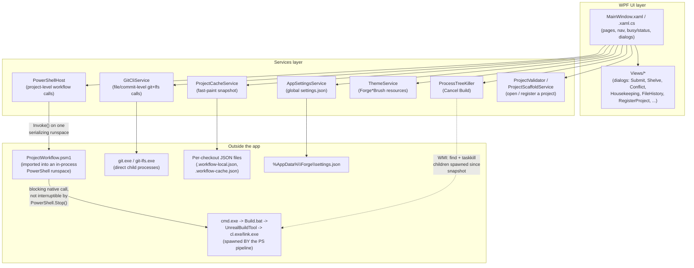

# Forge architecture

This is the map for anyone making changes to Forge itself. It assumes you've
read the root [README.md](../README.md) for what Forge *does*; this is about
how it's built.

See also:

- [POWERSHELL_HOSTING.md](POWERSHELL_HOSTING.md) -- the PowerShell runspace,
  output capture, the `ConvertFrom<T>` mapper, and how to add a new wrapped
  workflow command.
- [UI_PATTERNS.md](UI_PATTERNS.md) -- the WPF/XAML conventions a new page or
  feature should follow (navigation, busy/status, theming, filter toolbars).
- [DATA_AND_PERSISTENCE.md](DATA_AND_PERSISTENCE.md) -- the three JSON files
  Forge reads/writes, what lives where and why, and the project-open
  cache-then-refresh flow.

## What Forge is, architecturally

Forge is a WPF (.NET 7, Windows-only) shell around a project's own
`Tools\ProjectWorkflow.psm1` -- the same PowerShell module that project's
`Setup.bat`/`Sync.bat`/`Launch.bat` already use on the command line. **Forge
does not reimplement git/build workflow logic.** It hosts a real PowerShell
runspace in-process, imports that module, and calls its functions. This is
the single most important design decision in the codebase: safety behavior
(unsaved-work detection, pin-vs-upstream state, LFS placeholder detection,
the pinned-version check before a build, etc.) lives in exactly one place,
shared between the GUI and the CLI scripts. If you're tempted to reimplement
some workflow rule directly in C# instead of calling into the module, that's
almost always the wrong call -- it creates a second place that rule can
drift out of sync with the CLI tools everyone else still uses.

The one deliberate exception is **file-level and commit-level git
operations** (status, locks, history, commit/push, pin bumps, stash,
conflict resolution) -- these go through `GitCliService`, which shells out to
`git`/`git-lfs` directly via `Process`, bypassing PowerShell entirely. See
[POWERSHELL_HOSTING.md](POWERSHELL_HOSTING.md#why-two-layers) for why.

## System diagram



## Project layout

```
Forge/                          repo root
├── README.md                   user-facing overview, build/run/publish
├── docs-dev/                   you are here -- NOT shipped with the app
└── src/Forge/
    ├── MainWindow.xaml(.cs)    the whole app is one window; pages are
    │                           Grids toggled by ShowPage (see UI_PATTERNS.md)
    ├── App.xaml(.cs)           WPF-UI theme dictionaries, fallback brushes
    ├── Converters/             IValueConverter classes used from XAML
    ├── Models/                 plain data classes + a few view-model-ish
    │                           classes with INotifyPropertyChanged
    │                           (FileTreeNode, SubmoduleNode, LogEntry)
    ├── Services/                see table below
    ├── Views/                   dialog windows (XAML + code-behind pairs)
    ├── docs/                    USER docs -- shipped next to the exe,
    │                           CopyToOutputDirectory, rendered in the
    │                           Help tab (see using-forge.md itself for
    │                           how a project adds its OWN docs there too)
    └── templates/
        └── ProjectWorkflow.psm1  bundled copy used to scaffold a new
                                   project via "Register a Project"
                                   (see DATA_AND_PERSISTENCE.md)
```

| Service | Responsibility |
|---|---|
| `PowerShellHost` | Owns the per-project PowerShell runspace; exposes `ProjectWorkflow.psm1` functions as async C# calls. See [POWERSHELL_HOSTING.md](POWERSHELL_HOSTING.md). |
| `ForgePSHost` / `ForgeHostUserInterface` | The `PSHost` implementation that captures `Write-Host`/`Write-Warning`/etc. instead of writing to a real console, including the `ConsoleColor` the module chose -- this is what feeds the Log tab. |
| `GitCliService` | Direct `git`/`git-lfs` process calls for anything that scales with file count: status, locks, file history, commit/push, pin bumps, stash, conflict resolution. |
| `ProjectCacheService` | Load/save `Tools\.workflow-cache.json` -- a disposable fast-paint snapshot, never the source of truth. |
| `AppSettingsService` | Load/save `%AppData%\Forge\settings.json` -- recent projects list, theme settings. Global, not per-project. |
| `ThemeService` | Owns `ThemeSettings`, drives WPF-UI's own Light/Dark/Mica, and maintains the `Forge*Brush` `DynamicResource` entries everything else binds to. |
| `ProjectValidator` | One-line check: does a folder have both `Tools\ProjectWorkflow.psm1` and `project.config.json`? |
| `ProjectScaffoldService` | "Register a Project": copies the bundled template module + writes a minimal `project.config.json` into a folder that has a `.uproject` but isn't Forge-set-up yet. |
| `ProcessTreeKiller` | Cancel Build: finds and kills the native process tree a build spawned, since `PowerShell.Stop()` can't. |

## Key design decisions (and why)

- **Wrap the module, don't reimplement it.** Covered above -- this is the
  load-bearing decision. Every new feature question should start with "does
  `ProjectWorkflow.psm1` already know how to do this?"
- **One runspace, one semaphore.** `PowerShellHost` serializes every call
  (foreground clicks *and* background branch-prefetch) through a single
  `SemaphoreSlim` gate, because a PowerShell `Runspace` can only run one
  pipeline at a time. See [POWERSHELL_HOSTING.md](POWERSHELL_HOSTING.md).
- **Buttons stay enabled; busy state is communicated, not enforced via
  `IsEnabled=false`.** A second click during a long operation just queues
  behind the gate (harmless) except at the handful of call sites where
  queuing would be *confusing* (Sync/Build/Submit/opening a different
  project), which explicitly decline via `DeclineIfBusy()` instead. See
  [UI_PATTERNS.md](UI_PATTERNS.md).
- **Per-checkout state is split by how shareable it is.** Submodule
  paths/editor target (`project.config.json`) are committed and shared.
  Watch-branch choices, the LFS flag, and now an external engine path
  (`Tools\.workflow-local.json`) are machine-specific and gitignored. A
  disposable UI-only snapshot (`Tools\.workflow-cache.json`) is a second,
  separate gitignored file rather than being folded into
  `.workflow-local.json` -- it's not configuration, it's cache, and the two
  have very different lifetimes and failure handling (a corrupt cache is
  silently discarded; a corrupt local-settings file is not). See
  [DATA_AND_PERSISTENCE.md](DATA_AND_PERSISTENCE.md).
- **Semantic status colors (success/warn/danger) are not
  user-customizable**, only accent/background/icon are (`ThemeService`).
  Keeping meaning separate from branding means a user picking a wild accent
  color can never accidentally make "this file is locked" and "this file
  conflicts" look the same.
- **Cancellation of a running build needed an OS-level answer, not a
  PowerShell-level one.** `Invoke-ProjectBuild` compiles via a blocking
  `& cmd.exe /c "Build.bat ..."` call. `PowerShell.Stop()` can only
  interrupt a pipeline at a script checkpoint -- never a thread blocked
  waiting on a native child process -- so it does not actually stop a
  running compile. `ProcessTreeKiller` kills the real OS process tree
  instead, scoped to only what the current build spawned (never a
  pre-existing or `UnrealEditor*` process). See
  [POWERSHELL_HOSTING.md](POWERSHELL_HOSTING.md#cancelling-a-running-build).

## Known limitations

- Windows only -- WPF, WinForms (folder picker), WMI (`System.Management`),
  and `taskkill.exe` are all Windows-specific. A cross-platform version
  would mean replacing the UI framework, not porting this one.
- Forge does not check whether a project's `ProjectWorkflow.psm1` is behind
  the canonical version of that file (or Forge's own bundled
  `templates/ProjectWorkflow.psm1`); keeping those in sync across projects
  is manual.
- "Register a Project" only supports the simple case (no separate
  Game/Engine submodules -- see `ProjectScaffoldService`). Cloning a
  brand-new superproject from scratch is still not supported; the project
  folder has to already exist.
