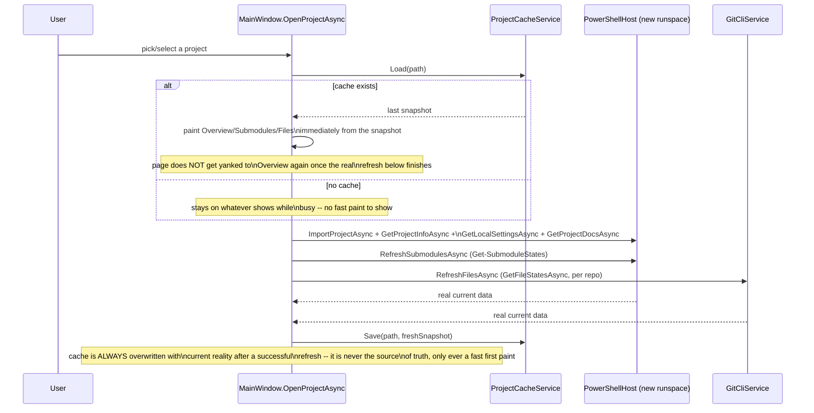
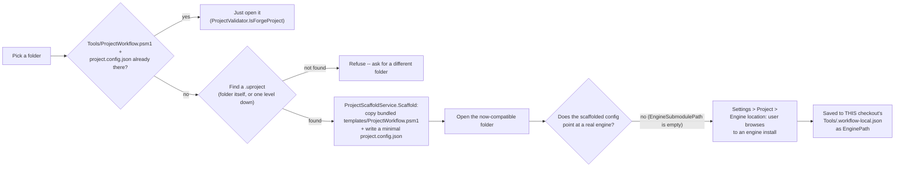

# Data and persistence

Forge reads/writes three separate JSON files, each with a different scope,
lifetime, and failure-handling policy. Picking the right one for new
settings/state matters -- see [Which file for a new setting?](#which-file-for-a-new-setting)
at the bottom.

| File | Scope | Shared with the team? | Source |
|---|---|---|---|
| `%AppData%\Forge\settings.json` | This machine's Forge install | No | `AppSettingsService` |
| `Tools\.workflow-local.json` | This checkout, this machine | No (gitignored) | `PowerShellHost.GetLocalSettingsAsync`/`SetLocalSettingsAsync`, read by `ProjectWorkflow.psm1` itself |
| `Tools\.workflow-cache.json` | This checkout, this machine | No (gitignored) | `ProjectCacheService` |
| `project.config.json` | The project, committed | **Yes** | Read directly by `ProjectWorkflow.psm1`; Forge never writes to an *existing* one (only `ProjectScaffoldService` writes a fresh one) |

## `%AppData%\Forge\settings.json` -- global app state

Owned by `AppSettingsService`. Two things live here, both genuinely global
to the Forge *install*, not any particular project:

- `RecentProjects` -- the last 10 project folders opened, newest first
  (`AddRecent` dedupes and trims).
- `Theme` (`ThemeSettings`) -- mode (Light/Dark/System) plus
  accent/background/icon colors per mode. See
  [UI_PATTERNS.md](UI_PATTERNS.md#theming).

A corrupt or missing file is silently replaced with `new AppSettings()` --
this file holding stale/bad data should never stop Forge from starting.

## `Tools\.workflow-local.json` -- per-checkout, machine-specific config

This file is **not Forge's own invention** -- `ProjectWorkflow.psm1` reads
it directly (it predates Forge; the CLI scripts use it too). Forge's
`LocalSettings` model and `PowerShellHost.GetLocalSettingsAsync`/
`SetLocalSettingsAsync` are a C# mirror of it, mapped by hand in
`PowerShellHost.ConvertLocalSettings` (not the generic `ConvertFrom<T>` --
see [POWERSHELL_HOSTING.md](POWERSHELL_HOSTING.md#mapping-powershell-output-to-c-convertfromt),
because it needs a nested `WatchBranches` dictionary the generic reflection
mapper can't express).

What lives here, and why it can never move to the shared
`project.config.json`:

- **`WatchBranches`** -- per-submodule "notify me if this gets ahead"
  choices. Personal to whoever set them.
- **`EnableLfsLocking`** -- a feature flag, machine-specific by design.
- **`NotifyOnUnlock`** -- the list of files this machine is watching for an
  unlock notification.
- **`EnginePath`** -- an absolute filesystem path override for an engine
  that isn't the bundled submodule (see
  [Register a Project](#register-a-project-and-enginepath) below). This is
  the clearest example of *why* this file must stay per-checkout:
  every teammate's engine install lives at a different absolute path, so
  committing one into `project.config.json` would break everyone else's
  checkout the moment it synced.

`ProjectWorkflow.psm1` reads `EnginePath` **before** computing `$EngineDir`:
if present, it's used directly; otherwise the module falls back to its
original `Join-Path $Root $Config.EngineSubmodulePath` derivation.
`Get-ProjectInfo` also reports `IsEngineExternal` (`[bool]$LocalEnginePathOverride`)
so the UI can say so.

## `Tools\.workflow-cache.json` -- disposable fast-paint snapshot

This one **is** Forge's own invention, and is a genuinely different kind of
file from `.workflow-local.json` even though it lives next to it: it's
*cache*, not *configuration*. `ProjectCacheService.Load`/`Save` never throw
-- a missing or corrupt cache file just means no fast paint this time, not
an error the user sees. Contents: `ProjectInfo`, a flattened
`List<SubmoduleState>`, the file list, and a `CachedAt` timestamp
(`Models/ProjectCache.cs`).

### Project-open sequence

The fast-paint snapshot is explicitly allowed to be stale -- that's the
whole point, it trades a few seconds of possible staleness for an instant
first paint instead of a blank/busy window while PowerShell imports the
module and git scans every repo. The real refresh that follows always wins.

## Register a Project, and `EnginePath`

"Register a Project" (`Views/RegisterProjectDialog`, `ProjectScaffoldService`)
is how a `.uproject`-containing folder that **isn't** Forge-compatible yet
becomes compatible, without hand-editing anything:

The scaffolded `project.config.json` deliberately leaves
`EngineSubmodulePath`/`GameSubmodulePath` empty (`ProjectScaffoldService`
verified this is safe via `Join-Path $Root ""` -- it resolves to the
project root itself, not an error) -- this is scoped to the simple case of
a project with no separate Game/Engine submodules. An engine is then
supplied **afterward** via `LocalSettings.EnginePath`, never baked into the
scaffolded config, for the same machine-specific reason described above.

## Which file for a new setting?

Ask, in order:

1. **Does every teammate need the same value for the project to work at
   all** (a submodule path, the editor target, the list of required
   submodules)? → `project.config.json`. Forge does not write to an
   existing one of these; a human edits it, or `ProjectScaffoldService`
   writes a fresh one for a brand-new registration.
2. **Is it inherently specific to one person's machine or one checkout**
   (a filesystem path, a personal notification preference, a local feature
   flag)? → `Tools\.workflow-local.json`, via `LocalSettings` +
   `PowerShellHost`. Ask: would committing this value break someone else's
   checkout? If yes, it belongs here, not in `project.config.json`.
3. **Is it genuinely about the Forge install itself, not any project**
   (recent-projects list, theme)? → `%AppData%\Forge\settings.json`, via
   `AppSettingsService`.
4. **Is it disposable -- safe to lose, rebuilt automatically, never
   authoritative?** → `Tools\.workflow-cache.json`, via
   `ProjectCacheService`. Don't put anything here that would be a real loss
   if the file silently failed to load; that's what (2) is for.
