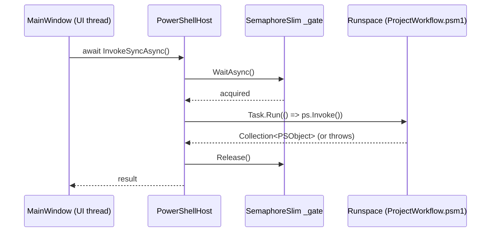

# PowerShell hosting

How Forge talks to `ProjectWorkflow.psm1`, and how to add a new call.

## The runspace

`PowerShellHost` (`Services/PowerShellHost.cs`) opens **one** PowerShell
`Runspace` per opened project (a fresh one each time `OpenProjectAsync`
runs -- see [DATA_AND_PERSISTENCE.md](DATA_AND_PERSISTENCE.md)), imports
that project's `Tools\ProjectWorkflow.psm1` into it, and exposes its
functions as `async Task<T>` methods. Pipeline execution (`PowerShell.Invoke()`)
is synchronous, so every call runs via `Task.Run` on a background thread --
callers are always expected to `await` from the UI thread, never block on
the result.



### Why one gate for everything

A `Runspace` can only run one pipeline at a time. Two things both call into
it: the user clicking a button (Sync, Build, a file History lookup, ...) and
a 15-minute background timer that prefetches branch lists
(`PrefetchAllBranchesAsync`). Without serializing, those two threads would
race on the same runspace and PowerShell throws. `_gate` (a
`SemaphoreSlim(1, 1)`) queues them instead: whichever call arrives second
just waits its turn rather than crashing.

This is also *why* the UI layer has its own, separate `_isBusy` flag
(`MainWindow.xaml.cs`) and `DeclineIfBusy()` pattern -- see
[UI_PATTERNS.md](UI_PATTERNS.md#busy-state). The gate guarantees
*correctness* (no corrupted runspace state); `_isBusy` is purely about
*not silently queuing a Submit behind an in-flight Sync*, which would be
confusing even though it wouldn't crash anything.

## Output capture: `ForgePSHost`

`Services/ForgePSHost.cs` implements a minimal `PSHost`/`PSHostUserInterface`
(`ForgeHost`/`ForgeHostUserInterface`) whose `Write*` overrides don't write
to a real console -- they raise a C# event instead:

```csharp
public event EventHandler<HostOutputEventArgs>? OutputReceived;
```

This is how `Write-Host`/`Write-Warning`/`Write-Error`/etc. calls made
*inside the module* reach the Log tab, with **zero changes needed to
`ProjectWorkflow.psm1`** -- it has no idea it's running inside Forge instead
of a real console.

The important detail: `ProjectWorkflow.psm1`'s own `Write-Step`/`Write-Ok`/
`Write-Warn`/`Write-Dim` helpers are all just `Write-Host -ForegroundColor
<color>` calls (not `Write-Warning`, even for `Write-Warn` -- see the
module's own `function Write-Warn`). `HostOutputEventArgs.Foreground`
carries that `ConsoleColor` through to C#, and `Models/LogEntry.Classify`
turns `(stream, color)` into a `LogLevel` the Log tab colors and filters by.
**If you add a new `Write-*` helper to the module, make sure its intended
severity has a real mapping in `LogEntry.Classify` -- otherwise it silently
renders as plain `Info`.**

## Mapping PowerShell output to C#: `ConvertFrom<T>`

Most `Get-*` functions in the module return a `PSCustomObject` (or array of
them). `PowerShellHost.ConvertFrom<T>` maps one by **reflection, matching
property names exactly** -- there is no `[JsonPropertyName]`-style
attribute, so a C# model's property names must match the PowerShell
object's property names character-for-character (see
`Models/ProjectInfo.cs`'s own header comment, which says this explicitly).

```csharp
private static T ConvertFrom<T>(PSObject? obj) where T : new()
{
    var result = new T();
    if (obj == null) return result;              // tolerate a stray null
    foreach (var prop in typeof(T).GetProperties())
    {
        var psProp = obj.Properties[prop.Name];   // name match, not position
        if (psProp?.Value == null) continue;
        if (prop.PropertyType == typeof(string[])) { /* ... */ }
        else if (prop.PropertyType == typeof(int))  { /* ... */ }
        else if (prop.PropertyType == typeof(bool)) { /* ... */ }
        else { prop.SetValue(result, psProp.Value.ToString()); }
    }
    return result;
}
```

Two gotchas, both real bugs hit and fixed in this codebase, worth knowing
before you add a new type here:

1. **It only special-cases `string[]`, `int` and `bool`.** Anything else
   falls through to `.ToString()`. A new `DateTimeOffset`/`double`/enum
   property on a model will silently become a string-ified garbage value,
   not a compile error. Add a branch for any new type you introduce.
2. **`obj` itself can be a literal `null`**, not just missing properties on
   a real object. A PowerShell function that implicitly returns `$null`
   (e.g. `@($Config.Docs)` when `.Docs` is absent -- see
   `Get-ProjectDocs`) puts a real `null` in the `Collection<PSObject>`
   results, and `ConvertFrom` used to NRE on `obj.Properties[...]`. Always
   `.Where(r => r != null)` before mapping a list, and `ConvertFrom` itself
   now tolerates a null `obj` as a second line of defense -- keep that
   guard if you touch this method.

A couple of models (`LocalSettings` via `ConvertLocalSettings`) have a
hand-written mapper instead because they need real structure (a nested
`WatchBranches` dictionary) that the generic reflection mapper can't
express. Follow that pattern -- not the generic one -- if a new type needs
anything beyond flat scalar/array properties.

## Error translation

`ProjectWorkflow.psm1`'s `Fail()` throws a `WorkflowFailException` -- a type
**compiled at module-import time** via the module's own `Add-Type` call, in
an assembly Forge never references directly. That means C# literally cannot
`catch (WorkflowFailException)`. `PowerShellHost.Translate` works around
this by walking the exception chain and matching on `GetType().FullName`
instead of a type reference:

```csharp
private static Exception Translate(Exception ex)
{
    for (var current = ex; current != null; current = current.InnerException)
        if (current.GetType().FullName == "ProjectWorkflow.WorkflowFailException")
            return new ForgeWorkflowException(current.Message);
    return new ForgeUnexpectedException(ex.Message, ex);
}
```

Every call site in `MainWindow.xaml.cs` catches both resulting types
differently: `ForgeWorkflowException` is an **expected, named failure** (the
module's own validation refused for a specific, user-facing reason) and
shows as the message verbatim in the fail banner. `ForgeUnexpectedException`
means something actually broke -- a real bug, a missing file, a .NET
exception that escaped the pipeline -- and shows with an "Unexpected
error:" prefix. Keep that distinction when adding new error handling;
don't conflate "the module correctly refused to do something dangerous"
with "something is broken."

## How to add a new wrapped command

1. Add (or reuse) a function in `ProjectWorkflow.psm1` using the module's
   own `Write-Step`/`Write-Ok`/`Write-Warn`/`Fail` conventions. **Update
   both** the canonical copy (in each real project, e.g. CORE-Super's
   `Tools\ProjectWorkflow.psm1`) **and** Forge's bundled scaffold template
   (`src/Forge/templates/ProjectWorkflow.psm1`) -- Forge does not check
   these are in sync (see
   [ARCHITECTURE.md](ARCHITECTURE.md#known-limitations)).
2. If it returns data, give the returned `PSCustomObject`'s properties
   names that exactly match a (new or existing) C# model in `Models/`.
3. Add an `InvokeXAsync`/`GetXAsync` method to `PowerShellHost`, following
   the existing ones' shape (`ps.AddCommand(...).AddParameter(...)`, then
   either `ConvertFrom<T>` a single result or `.Select(ConvertFrom<T>)` a
   list).
4. Call it from `MainWindow.xaml.cs`, inside a `try`/`catch
   (ForgeWorkflowException)`/`catch (ForgeUnexpectedException)` like every
   other handler. If it's a long-running operation the user could confuse
   with another (Sync/Build/Submit), follow the `DeclineIfBusy()` +
   `SetBusy`/`SetStatus` pattern -- see
   [UI_PATTERNS.md](UI_PATTERNS.md#busy-state).

## Cancelling a running build

`PowerShell.Stop()` is the "normal" way to interrupt a running pipeline, but
it cannot actually stop a build. `Invoke-ProjectBuild` compiles via a
**blocking native call**:

```powershell
& cmd.exe /c "`"$BuildBat`" $($buildArgs -join ' ')"
```

A thread executing that line is blocked inside .NET's `Process.WaitForExit`
machinery until `cmd.exe` (and the whole `Build.bat` -> UnrealBuildTool ->
`cl.exe`/`link.exe` tree underneath it) exits on its own.
`PowerShell.Stop()` can only interrupt a pipeline at the *next script
checkpoint* -- never a thread stuck waiting on a native child process --
so calling it here does nothing until the build already finishes, which
defeats the purpose.

`Services/ProcessTreeKiller.cs` solves this at the OS level instead of the
PowerShell level:

```mermaid
sequenceDiagram
    participant User
    participant MW as MainWindow
    participant PTK as ProcessTreeKiller
    participant WMI as WMI (Win32_Process)
    participant Tree as cmd.exe -> Build.bat -> UBT -> cl.exe/link.exe

    MW->>PTK: SnapshotChildPids() [before InvokeBuildAsync]
    MW->>MW: await _host.InvokeBuildAsync(...) [blocks]
    User->>MW: click "Cancel Build"
    MW->>PTK: KillNewChildren(snapshot)
    PTK->>WMI: query direct children of Forge.exe's PID
    PTK->>PTK: diff against snapshot -> only NEW pids
    PTK->>PTK: skip anything named UnrealEditor*
    PTK->>Tree: taskkill /PID <pid> /T /F  (per new child)
    Tree-->>MW: cmd.exe exits non-zero
    MW->>MW: & cmd.exe call returns; $LASTEXITCODE != 0
    MW->>MW: module's own Fail() throws WorkflowFailException
    MW->>User: caught as ForgeWorkflowException; _buildCancelRequested\nflag makes this show "Build canceled." not a scary banner
```

Why a *snapshot diff* instead of just killing every child of Forge.exe:
Forge.exe can legitimately have other child processes that must **not** be
touched -- most importantly, an `UnrealEditor.exe` left running from an
**earlier**, already-finished build-and-launch. `SnapshotChildPids()` is
taken right before the build starts, and `KillNewChildren` only ever acts
on PIDs that appeared *after* that snapshot. The `UnrealEditor*` name check
in `TryKillTree` is a second, belt-and-suspenders safety net on top of
that, in case a build had already reached its own launch-the-editor step
by the time Cancel was clicked.

`taskkill /PID <pid> /T /F` (not a direct `Process.Kill()`) is used
specifically for its `/T` flag, which recursively kills the *whole*
subtree under that one PID -- so only the direct child (`cmd.exe`) needs to
be found via WMI; everything `cmd.exe` itself spawned dies with it.

## Why two layers (`PowerShellHost` vs. `GitCliService`)

`GitCliService` (`Services/GitCliService.cs`) shells out to `git`/`git-lfs`
directly via `Process`, bypassing `PowerShellHost` entirely, for anything
that scales with file count: status, locks, file history, commit/push, pin
bumps, stash, conflict resolution. This is a second, narrower layer
*underneath* the Files/History pages specifically -- `ProjectWorkflow.psm1`
(via `PowerShellHost`) still owns every project-level workflow decision
(Sync, Build, Setup, submodule state).

Two reasons this is a separate path instead of adding more PowerShell
functions to the module:

1. **Scale.** These queries can run against thousands of tracked files.
   PowerShell pipeline overhead (object marshalling in particular) adds up
   at that scale in a way it never does for the occasional Sync/Build call.
2. **LFS lock/pointer semantics have no equivalent in the module.**
   `GitCliService`'s own header comment notes it's deliberately not
   LibGit2Sharp either, for the same reason: LibGit2Sharp has no concept of
   LFS locks or pointer files, which is most of what this service exists to
   read.

If you're adding a new Files/History feature, check whether it's a
*file/commit-level* git query (→ `GitCliService`, new `Process`-based
method) or a *project-level workflow* action (→ the module, via
`PowerShellHost`) before deciding where it goes.
